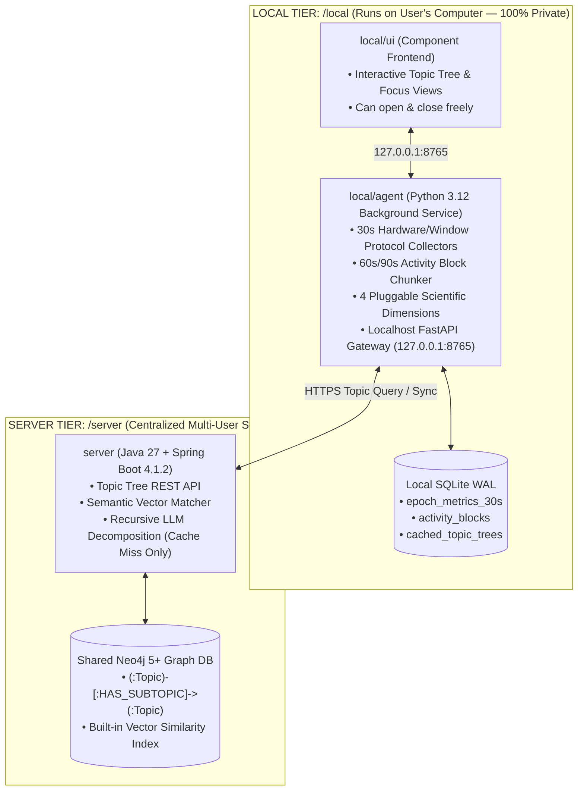

# EGG (`Microservice-egg`) — *"Don't crack under pressure"*

> **AI-Assisted Task Decomposition & Passive Local Cognitive Telemetry Platform for ADHD Executive Function Support.**

[](https://github.com/DevelopingPontus/Microservice-egg/actions/workflows/ci-local-agent.yml)
[](https://www.python.org/)
[](https://docs.astral.sh/uv/)
[](https://spring.io/projects/spring-boot)
[](https://neo4j.com/)
[](https://docs.astral.sh/ruff/)
[](https://mypy-lang.org/)

---

## 1. Product Brief & Neuropsychological Foundation (The "Why")

Standard productivity tools often fail users with ADHD because manual planning and timer logging add mental friction when executive function is already taxed. Grounded in Dr. Russell A. Barkley's **4 Prefrontal Cortex Executive Circuits** (*What, When, Why, Who*), **EGG** is built around **3 Core Pillars** (*"Your plan should be based on your worst days"*):

| Core Pillar | Brain Circuit | User Problem | Engineering Solution in `Microservice-egg` |
| :--- | :--- | :--- | :--- |
| **1. Cognitive Load** | *What Circuit* (Working Memory) | Big goals overwhelm working memory and cause task paralysis. | **`server/` Shared Topic-Tree Graph** (LLM "word unzipper" + Neo4j vector cache) & low-clutter **Mobile-First UI** (`local/ui`). |
| **2. Time & Flow** | *When Circuit* (Time Blindness) | Time blindness makes estimating task duration and effort difficult. | **`local/agent/` 30s Micro-Epochs** passively linking time to actual cognitive effort in local SQLite WAL. |
| **3. Emotional Weight & Energy** | *Why & Who Circuits* (Emotion & Self-Awareness) | Manual timer/fatigue logging causes burnout on low-energy days. | **4 Scientific Telemetry Dimensions** computed 100% locally on the user's device to estimate energy passively. |

### Team & Attribution
- **Pontus Olsson**: DevOps, Backend & System Architecture (`local/agent/`, `server/`, CI/CD).
- **Julia Ermanbriks**: UX Research, ADHD Executive Function Brief, Brand Identity, and Mobile-First UI Design (`local/ui/`).

---

## 2. Two-Tier Architecture (`local/` vs. `server/`)

The monorepo is structured at the root into **`local/`** (running on the user's computer — 100% private) and **`server/`** (running as a centralized multi-user service) along a strict **privacy and compute boundary**:



### Architectural Tiers

| Directory | Stack | Responsibility | Status |
| :--- | :--- | :--- | :--- |
| **`/local/agent`** | Python 3.12, `uv`, `aiosqlite`, `pynput`, `FastAPI` | Always-on background daemon collecting 30s epochs, chunking 60s/90s activity blocks, evaluating scientific dimensions, caching active topic trees in local SQLite, and serving `127.0.0.1:8765`. | In Progress (`Phase 1–2`) |
| **`/local/ui`** | Component Frontend | User-facing local interface consuming `127.0.0.1:8765` for viewing focus telemetry and interacting with broken-down topic trees. | Planned (`Phase 4`) |
| **`/server`** | Java 27, Spring Boot 4.1.2, Spring Data Neo4j, Neo4j 5+ | Central Shared Topic-Tree Service. Uses Neo4j vector similarity search to match semantically equivalent topics and reuse existing topic subtrees without redundant LLM calls. | Planned (`Phase 3`) |

---

## 3. Core Engineering & DevOps Guardrails

1. **Uncompromised Privacy by Construction (`local/agent`)**:
   - **Telemetry Never Leaves the Machine**: All 30s epochs and activity blocks stay strictly in local SQLite on the user's computer.
   - **Zero Keystroke Content**: Key characters, key codes, scancodes, and clipboard text are never inspected, buffered, or stored.
   - **Executable Sanitization**: Window polling resolves strictly to executable/bundle names (`Code.exe`, `iTerm2`, `firefox`)—stripping all window titles, file names, and URLs.
2. **Cache-First Graph & Vector Topic Resolution (`server`)**:
   - Topic breakdowns unpacked by the LLM ("word unzipper") are stored in a shared **Neo4j** graph database (`(:Topic)-[:HAS_SUBTOPIC]->(:Topic)`).
   - Using Neo4j Vector Indexes, if a user requests a topic phrased slightly differently from an existing topic, the Spring Boot service resolves it to the existing `:Topic` node and returns its tree immediately without redundant LLM calls.
3. **Hardware Decoupling via Python Protocols (`--simulate`)**:
   - Hardware hooks (`pynput`, `NSWorkspace`, `win32gui`, `Xlib`) fail inside headless Linux Docker containers and CI runners.
   - All collectors implement `InputListenerProtocol` and `WindowResolverProtocol`, enabling deterministic synthetic workloads in Docker Compose and GitHub Actions.
4. **Lossless Algebraic Pooling**:
   - Every 30-second epoch stores `iki_count` ($N$), `iki_sum_ms` ($\sum x$), and `iki_sum_sq_ms` ($\sum x^2$) so downstream queries compute exact pooled variance ($\sigma^2_{\text{pooled}} = \frac{\sum x^2}{N} - \mu^2_{\text{pooled}}$) across arbitrary time windows without distortion.

---

## 4. Architecture & Scoped Context Documentation

- **[`AGENTS.md`](./AGENTS.md)**: Global product brief, neuropsychological foundation, and privacy/security invariants.
- **[`local/agent/AGENTS.md`](./local/agent/AGENTS.md)**: Scoped architecture, SQLite schemas, scientific dimensions, and quality gates for the Python background service.
- **[`local/ui/AGENTS.md`](./local/ui/AGENTS.md)**: Mobile-first ADHD design principles and local API contract (`127.0.0.1:8765`).
- **[`server/AGENTS.md`](./server/AGENTS.md)**: Shared Topic-Tree service (`Java 27` + `Spring Boot 4.1.2` + `Neo4j` Vector Search) specification.
- **[`DEVOPS_PORTFOLIO_PLAN.md`](./DEVOPS_PORTFOLIO_PLAN.md)**: Full system architecture (`local/` + `server/`) and 4-phase implementation roadmap.
- **[`local/agent/epoch_telemetry_plan.md`](./local/agent/epoch_telemetry_plan.md)**: Detailed technical specification for the 30s epoch ingestion engine.

---

## 5. Quickstart (`local/agent`)

```bash
cd local/agent

# 1. Install locked dependencies via uv
uv sync

# 2. Run the mandatory verification loop
uv run ruff check .
uv run ruff format --check .
uv run mypy --strict app tests
uv run pytest --cov=app --cov-fail-under=90
```
