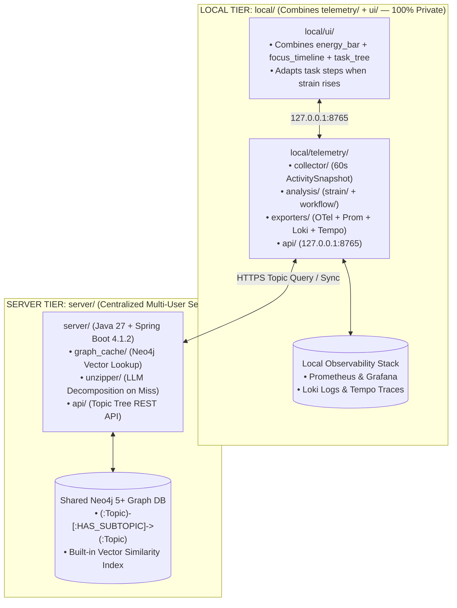

# EGG (`Microservice-egg`) — *"Don't crack under pressure"*

> **AI-Assisted Task Decomposition & Passive Local Cognitive Telemetry Platform for ADHD Executive Function Support.**

[](https://github.com/DevelopingPontus/Microservice-egg/actions/workflows/ci-local-agent.yml)
[](https://www.python.org/)
[](https://docs.astral.sh/uv/)
[](https://spring.io/projects/spring-boot)
[](https://neo4j.com/)
[](https://docs.astral.sh/ruff/)
[](https://mypy-lang.org/)

---

## 1. Product Brief & Neuropsychological Foundation (The "Why")

Standard productivity tools often fail users with ADHD because manual planning and timer logging add mental friction when executive function is already taxed. Grounded in Dr. Russell A. Barkley's **4 Prefrontal Cortex Executive Circuits** (*What, When, Why, Who*), **EGG** is built around **3 Core Pillars** (*"Your plan should be based on your worst days"*):

| Core Pillar | Brain Circuit | User Problem | Engineering Solution in `Microservice-egg` |
| :--- | :--- | :--- | :--- |
| **1. Cognitive Load** | *What Circuit* (Working Memory) | Big goals overwhelm working memory and cause task paralysis. | **`server/` Shared Topic-Tree Graph** (`graph_cache/` + `unzipper/`) & low-clutter **Mobile-First UI** (`local/ui/`). |
| **2. Time & Flow** | *When Circuit* (Time Blindness) | Time blindness makes estimating task duration and effort difficult. | **`local/telemetry/` Rolling 60s Collector & Workflow Sessions** passively linking time to actual cognitive effort via OpenTelemetry. |
| **3. Emotional Weight & Energy** | *Why & Who Circuits* (Emotion & Self-Awareness) | Manual timer/fatigue logging causes burnout on low-energy days. | **Pure Local Cognitive Analysis (`analysis/strain/` + `analysis/workflow/`)** computed 100% locally on the user's device. |

### Team & Attribution

- **Pontus Olsson**: DevOps, Backend & System Architecture (`local/telemetry/`, `server/`, CI/CD).
- **Julia Ermanbriks**: UX Research, ADHD Executive Function Brief, Brand Identity, and Mobile-First UI Design (`local/ui/`).

---

## 2. Recursive Feature-Module Architecture ("Every Folder is a Module")

Every directory in `Microservice-egg` is a **standalone module divided by feature** that combines its direct children to create higher-level functionality:



### What Each Layer Combines to Work by Itself

| Module / Folder | Direct Children Combined | Standalone Capability Created |
| :--- | :--- | :--- |
| **`Microservice-egg/`** | `local/` + `server/` | Complete distributed platform connecting the private personal workspace (`local/`) with the shared topic cache (`server/`). |
| **`local/`** | `telemetry/` + `ui/` | 100% private, offline-capable personal workspace where `ui/` reads live cognitive state from `telemetry/` (`127.0.0.1:8765`). |
| **`local/telemetry/`** | `collector/` + `analysis/` + `exporters/` + `api/` | Background Python 3.12 daemon and SRE observability suite. |
| **`telemetry/app/collector/`** | `input_hook` + `window_probe` + `sliding_window` | Self-contained 60s hardware/window sensor producing an anonymized `ActivitySnapshot` and tick deltas. |
| **`telemetry/app/analysis/`** | `strain/` + `workflow/` | Pure cognitive engine (zero I/O) evaluating both the 4 SRE dimensions (`strain/`) and 6 Overview dimensions (`workflow/`). |
| **`telemetry/app/exporters/`** | `otel` + `metrics` + `logs` + `traces` | Unified observability sink publishing state to OpenTelemetry, Prometheus, Loki, and Tempo via a single `.publish()` call. |
| **`telemetry/app/api/`** | `routes` + `server` | Loopback FastAPI gateway (`127.0.0.1:8765`) serving `/health`, `/metrics`, `/api/v1/status`, and `/api/v1/state`. |
| **`local/ui/`** | `energy_bar/` + `focus_timeline/` + `task_tree/` | Mobile-first ADHD interface that resizes task steps when cognitive strain rises. |
| **`server/`** | `graph_cache/` + `unzipper/` + `api/` | Cache-first Spring Boot + Neo4j service that reuses existing topic subtrees and invokes the LLM only on cache misses. |

---

## 3. Core Engineering & DevOps Guardrails

1. **Uncompromised Privacy by Construction (`local/`)**:
   - **Telemetry Never Leaves the Machine**: Private telemetry remains strictly on the user's computer.
   - **Zero Keystroke Content**: Key characters, key codes, scancodes, and clipboard text are never inspected, buffered, or stored.
   - **Executable Sanitization**: Window polling resolves strictly to executable/bundle names (`Code.exe`, `iTerm2`, `Firefox.app`)—stripping all window titles, file names, and URLs.
2. **Cache-First Graph & Vector Topic Resolution (`server/`)**:
   - Topic breakdowns unpacked by the LLM ("word unzipper") are stored in a shared **Neo4j** graph database (`(:Topic)-[:HAS_SUBTOPIC]->(:Topic)`).
   - Using Neo4j Vector Indexes, semantically equivalent topics resolve to existing `:Topic` nodes immediately with `0` LLM calls.
3. **Headless Simulation (`--synthetic` / `--simulate`)**:
   - `collector/` supports deterministic synthetic input and window schedules so the entire stack runs identically inside headless Docker containers and GitHub Actions runners.
4. **Lossless Algebraic Pooling**:
   - Every sliding window stores `iki_count` ($N$), `iki_sum_ms` ($\sum x$), and `iki_sum_sq_ms` ($\sum x^2$) so downstream queries compute exact pooled variance ($\sigma^2_{\text{pooled}} = \frac{\sum x^2}{N} - \mu^2_{\text{pooled}}$) across arbitrary time windows without distortion.

---

## 4. Architecture Rules & Standalone Subsystem Guides

- **[`AGENTS.md`](./AGENTS.md)**: Single source of truth for architectural rules (Standalone Subsystems marked by `README.md`, One-Way Pipeline, Public Facade Encapsulation, Universal `exporters/` vs. Concrete `observability/`, and Architectural Fitness Functions).
- **[`local/telemetry/README.md`](./local/telemetry/README.md)**: Standalone full SRE observability suite (`uv run run.py` — Docker Grafana, Prometheus, Loki, Tempo + daemon).
- **[`local/telemetry/app/README.md`](./local/telemetry/app/README.md)**: Standalone lightweight Python daemon (`uv run python -m app` — runs without Docker).
- **[`local/ui/README.md`](./local/ui/README.md)**: Standalone mobile-first ADHD frontend (`energy_bar/`, `focus_timeline/`, `task_tree/`).
- **[`server/README.md`](./server/README.md)**: Standalone shared Topic-Tree service (`graph_cache/`, `unzipper/`, `api/`).
- **[`DEVOPS_PORTFOLIO_PLAN.md`](./DEVOPS_PORTFOLIO_PLAN.md)**: Full system architecture and phased implementation roadmap.

---

## 5. Quickstart (`local/telemetry`)

```bash
cd local/telemetry

# 1. Install locked dependencies via uv
uv sync

# 2. Run the complete stack (Docker observability containers + host telemetry daemon)
uv run run.py

# 3. Run the mandatory verification loop
uv run ruff check .
uv run ruff format --check .
uv run mypy --strict app tests run.py
uv run pytest --cov=app --cov-fail-under=90
```
