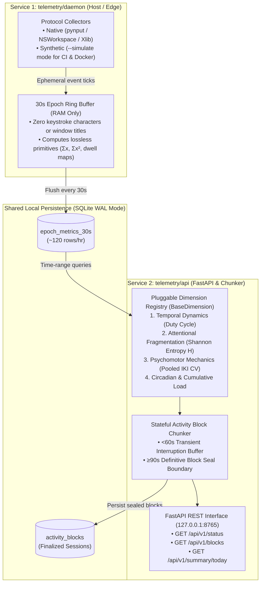

# `Microservice-egg` — Cognitive Telemetry & Executive-Function Platform

> **Privacy-by-Construction Cognitive Telemetry, Scientific Activity Block Engine & Modular Microservices for ADHD Executive Function.**

[](https://www.python.org/)
[](https://docs.astral.sh/uv/)
[](https://docs.astral.sh/ruff/)
[](https://mypy-lang.org/)

---

## 1. Project Context & Evolution

**Egg** (*"Don't crack"*) is a software initiative designed to help knowledge workers—particularly individuals with ADHD—manage cognitive load, decompose complex goals into actionable steps, and gain empirical self-insight into how they work.

Before starting this monorepo, specific problem domains were explored in standalone projects:
- **[`ai-gatherer`](https://github.com/DevelopingPontus/ai-gatherer)** *(Standalone Prototype)*: Validated strict JSON-schema LLM output enforcement, retry resilience, Docker packaging, and security analysis.
- **[`egg-ai`](https://github.com/DevelopingPontus/egg-ai)** *(Standalone Project)*: Evolved `ai-gatherer` into a recursive LLM task and topic decomposition engine. To keep context small enough for local consumer LLMs, it identifies a core topic, breaks it into sub-topics, and queries each node independently to form an ordered tree structure where leaf nodes become concrete execution steps.
- **[`workflow_assistant`](https://github.com/DevelopingPontus/workflow_assistant)** *(Standalone Project)*: Explored structured entity and topic modeling using 6 parameters (*Who, What, When, Where, Why, How* — 5W1H) for mindful task tracking and asynchronous check-ins.

**`Microservice-egg`** is the unified, production-grade microservice platform where the architectural lessons learned from those standalone iterations are brought together alongside the **Cognitive Telemetry & Activity Block Engine**:

| Domain / Service | Core Engineering Focus | Status |
| :--- | :--- | :--- |
| **`/telemetry/daemon`** | Local-first **30-second micro-epoch ingestion daemon** (`pynput`, OS window resolvers, Protocol DI, SQLite WAL lossless algebraic primitives). | In Progress (`Sprint 1.0` shipped) |
| **`/telemetry/api`** | **Pluggable Scientific Dimension Engine** (`BaseDimension`), **60s/90s Hysteresis Activity Block Chunker**, and **FastAPI REST service**. | Specified (`Phase 2`) |
| **Task Tree & 5W1H Domains** | Future microservice integration of the recursive tree decomposition (`egg-ai`) and 6-parameter 5W1H entity modeling (`workflow_assistant`) architectures. | Planned |

---

## 2. System Architecture: Cognitive Telemetry Domain (`/telemetry`)

Instead of storing invasive raw keystrokes or lossy pre-averaged statistics, the `/telemetry` domain splits collection and analysis into two isolated services communicating via an asynchronous **SQLite WAL** datastore:



---

## 3. Core Engineering & DevOps Pillars

1. **Uncompromised Privacy by Construction**:
   - **Zero Keystroke Content**: Key characters, key codes, scancodes, and clipboard text are never inspected, buffered, or stored.
   - **Executable Sanitization**: Window polling resolves strictly to executable/bundle names (`Code.exe`, `iTerm2`, `firefox`)—stripping all window titles, file names, and URLs.
   - **Localhost Only**: All HTTP endpoints bind strictly to `127.0.0.1`.
2. **Hardware Decoupling via Python Protocols (`--simulate`)**:
   - Hardware hooks (`pynput`, `NSWorkspace`, `win32gui`, `Xlib`) fail inside headless Linux Docker containers and CI runners.
   - All collectors implement `InputListenerProtocol` and `WindowResolverProtocol`, enabling deterministic synthetic workloads in Docker Compose and GitHub Actions.
3. **Lossless Algebraic Pooling**:
   - Every 30-second epoch stores `iki_count` ($N$), `iki_sum_ms` ($\sum x$), and `iki_sum_sq_ms` ($\sum x^2$) so downstream queries compute exact pooled variance ($\sigma^2_{\text{pooled}} = \frac{\sum x^2}{N} - \mu^2_{\text{pooled}}$) across arbitrary time windows without distortion.
4. **Hierarchical Context & Automated Quality Gates**:
   - Context-scoped [`AGENTS.md`](./AGENTS.md) rules per service directory.
   - Mandatory verification loop via **`uv`**: `ruff check`, `ruff format --check`, `mypy --strict`, and `pytest --cov=app --cov-fail-under=90`.

---

## 4. Repository Structure & Documentation

- **[`DEVOPS_PORTFOLIO_PLAN.md`](./DEVOPS_PORTFOLIO_PLAN.md)**: Full multi-service architecture and 3-phase DevOps implementation roadmap.
- **[`telemetry/daemon/epoch_telemetry_plan.md`](./telemetry/daemon/epoch_telemetry_plan.md)**: Detailed technical specification for the 30s epoch ingestion daemon.
- **[`telemetry_engine_detailed_plan.pdf`](./telemetry_engine_detailed_plan.pdf)**: Scientific literature grounding, `BaseDimension` specification, and REST API blueprint.
- **[`reports/`](./reports/README.md)**: Chronological Engineering Sprint Reports & Architecture Decision Records (ADRs):
  - [Sprint 1.0 — Domain-Scoped Monorepo, Privacy-by-Construction & DevOps Guardrails](./reports/01-sprint-1.0-monorepo-and-devops-guardrails.md)

---

## 5. Quickstart (`telemetry/daemon`)

```bash
cd telemetry/daemon

# 1. Install locked dependencies via uv
uv sync

# 2. Run the mandatory verification loop
uv run ruff check .
uv run ruff format --check .
uv run mypy --strict app tests
uv run pytest --cov=app --cov-fail-under=90
```
