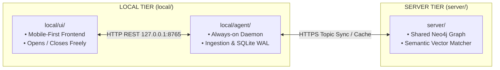

# `local/` Context & Interface Contract

> **Client Tier: 100% Private Local Telemetry Daemon & Mobile-First Component UI.**

---

## 1. What, Why, When & How

### What (Scope)
`local/` represents the **Local Client Tier** of the EGG platform. Everything within this directory executes exclusively on the user's personal computer. It consists of:
1. **`local/agent/`**: Always-on background Python 3.12 daemon collecting cognitive telemetry and serving `127.0.0.1:8765`.
2. **`local/ui/`**: Component-based user interface consuming localhost endpoints for task breakdown and focus visualization.

### Why (Rationale)
1. **Privacy Boundary**: In accordance with EGG's core privacy guarantee, private telemetry (keystroke rhythms, micro-pauses, app dwell distributions) **must never leave the user's machine**. Grouping these components under `local/` enforces a strict perimeter between local private data and the remote shared server (`server/`).
2. **Decoupled Lifecycle**: The background collector runs uninterrupted regardless of whether the user has the UI open, closed, minimized, or restarted.

### When (Lifecycle)
- **`agent/`**: Starts on computer boot or user login as a background service.
- **`ui/`**: Launched on demand whenever the user wants to view their focus dashboard or break down a new goal.

### How (Mechanics)
- Communication between `ui/` and `agent/` occurs strictly over **HTTP REST on localhost** (`http://127.0.0.1:8765`).
- `agent/` manages local persistence in an async SQLite WAL database (`local_agent.db`).
- Universal topic requests are routed via `agent/` to `server/`, caching results locally for offline support.

---

## 2. Interface Contract (Inputs & Outputs)

### Inputs
- Local OS hardware events and active window focus.
- User interactions in `local/ui/`.
- Universal topic graphs synced from `server/`.

### Outputs
- Real-time cognitive telemetry insights on `127.0.0.1:8765`.
- Rendered visual focus views and interactive topic decomposition trees in `local/ui/`.

### Invariants & Safety Guarantees
- **Zero Remote Telemetry**: Telemetry database rows and hardware events **must never** be transmitted to `server/` or external endpoints.
- **Localhost Binding**: All network listeners in `local/` must bind strictly to `127.0.0.1`.

---

## 3. Subfolder Routing (Child Directories)

- [`agent/`](./agent/AGENTS.md): Python 3.12 daemon, 30s epoch ingestion, 4-dimension scientific engine, SQLite WAL, and localhost FastAPI gateway (`127.0.0.1:8765`).
- [`ui/`](./ui/AGENTS.md): Mobile-first ADHD-focused component frontend for interactive topic trees and focus telemetry.
