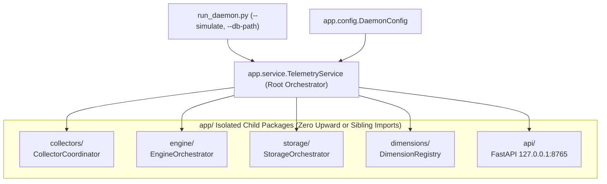

# `local/agent/app/` Context & Interface Contract

> **Core Python application package: Service lifecycle supervisor, configuration, and domain orchestration.**

---

## 1. What, Why, When & How

### What (Scope)

This package is the top-level Python application module for `local/agent`. It wires together the collectors, the accumulation engine, SQLite storage, scientific dimensions, and localhost API into an orchestrated, resilient daemon.

### Why (Rationale)

1. **Centralized Configuration**: Ensures all operational constants (polling rates, thresholds, database paths, pause intervals) are defined in a single immutable configuration file ([`config.py`](./config.py)) and validated via environment variables.
2. **Deterministic Lifecycle & Graceful Shutdown**: `service.py` provides a unified supervisor managing startup order (DB initialization $\rightarrow$ collectors hook $\rightarrow$ scheduler loop) and graceful shutdown (`SIGINT`/`SIGTERM`), guaranteeing in-flight buffer flushes so no telemetry is lost on exit.

### When (Lifecycle)

- Initialized by `run_daemon.py` when starting `local/agent`.
- Remains alive for the entire duration of the background service.

### How (Mechanics)

- **Startup**:
  1. Resolves configuration from `app.config`.
  2. Ensures the SQLite WAL database and schema exist via `app.storage.init_db()`.
  3. Instantiates `EpochBuffer` and creates appropriate collectors via `create_input_listener` and `create_window_resolver` (using `--simulate` flag if provided).
  4. Launches `EpochScheduler.run()`.
- **Shutdown**: Intercepts OS signals (`SIGINT`, `SIGTERM`), halts listener hooks, and forces a final `EpochScheduler.flush_now()` before closing database handles.

---

## 2. Interface Contract (Inputs & Outputs)

### Inputs

- CLI flags (`--simulate`, `--db-path`, `--epoch-seconds`, `--duration-seconds`) forwarded from `run_daemon.py`.
- Environment variables (`TELEMETRY_DB_PATH`, `TELEMETRY_EPOCH_SECONDS`).

### Outputs (Exported Public API)

- `TelemetryService`: Root orchestrator wiring `CollectorCoordinator`, `EngineOrchestrator`, `StorageOrchestrator`, and `DimensionRegistry`.
- `DaemonConfig` and configuration constants in `app.config`.

### Invariants & Safety Guarantees

- **Strict Downward-Only Dependency Tree**: `app/service.py` is the **only** module permitted to import across child folders (`collectors/`, `engine/`, `storage/`, `dimensions/`, `api/`) and `app/config.py`. Child folders must never import upward or sideways.
- **No Unpersisted Data on Shutdown**: `TelemetryService` must always execute a final `flush_now()` when stopped.
- **Strict Typing**: All internal modules must pass `mypy --strict`.

---

## 3. File Inventory

| File | Primary Exports & Classes | Responsibility |
| :--- | :--- | :--- |
| [`config.py`](./config.py) | `DaemonConfig`, `EPOCH_DURATION_SECONDS`, `WINDOW_POLL_INTERVAL_SECONDS`, `DEFAULT_DATABASE_PATH`, `IKI_MAX_OUTLIER_MS`, `MICRO_PAUSE_*` | Centralized system constants and environment configuration. |
| [`service.py`](./service.py) | `TelemetryService`, `build_arg_parser`, `run_from_cli` | Root orchestrator coordinating folder orchestrators (`collectors`, `engine`, `storage`, `dimensions`) and graceful teardown. |
| [`__init__.py`](./__init__.py) | Package marker | Package identity. |

---

## 4. Subfolder Routing (Child Packages)

Each subfolder has its own dedicated `AGENTS.md` interface contract:

- [`collectors/`](./collectors/AGENTS.md): Hardware keyboard/mouse hooks and frontmost window resolver (Protocol-driven).
- [`engine/`](./engine/AGENTS.md): 30s `EpochBuffer`, monotonic `EpochScheduler`, and activity chunking.
- [`storage/`](./storage/AGENTS.md): SQLite WAL persistence (`aiosqlite`) and lossless algebraic pooling math ($N, \sum x, \sum x^2$).
- [`dimensions/`](./dimensions/AGENTS.md): Pluggable 4-dimension scientific engine (Temporal, Attentional, Psychomotor, Circadian).
- [`api/`](./api/AGENTS.md): Localhost FastAPI gateway (`127.0.0.1:8765`) serving `local/ui`.
