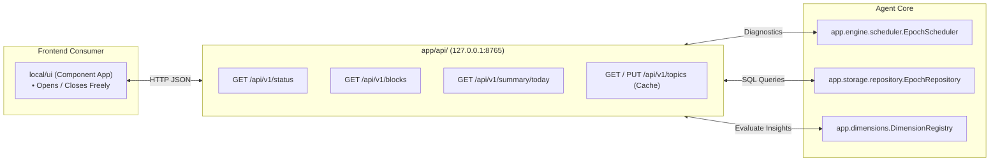

# `local/agent/app/api/` Context & Interface Contract

> **Localhost HTTP REST Gateway (`127.0.0.1:8765`) serving `local/ui` and caching topic trees.**

---

## 1. What, Why, When & How

### What (Scope)

This package exposes the internal SQLite data and real-time agent status as a local REST API over `127.0.0.1:8765`. It bridges the background telemetry daemon with user-facing frontends (`local/ui`) and caches remote topic decompositions from `server/`.

### Why (Rationale)

1. **Localhost Isolation**: Binds strictly to `127.0.0.1` so that telemetry is never exposed to external local network interfaces.
2. **Offline-First Resilience**: Caches topic trees downloaded from `server/` inside local SQLite, allowing users to navigate and advance tasks even when disconnected from the internet.
3. **Decoupled Frontend**: Allows `local/ui` to be opened and closed on demand without interrupting the background daemon's collection cycle.

### When (Lifecycle)

- Initialized alongside the daemon during `local/agent` startup.
- Serves HTTP requests whenever `local/ui` or external monitoring queries `http://127.0.0.1:8765`.

### How (Mechanics)

- Built with **FastAPI** and `uvicorn`.
- Exposes versioned REST routes under `/api/v1/`.
- Reads operational health directly from `EpochScheduler.diagnostics()` and activity data via `EpochRepository`.

---

## 2. Interface Contract (Inputs & Outputs)

### Inputs (HTTP Requests)

- `GET /health` & `GET /api/v1/status`: Health checks, scheduler uptime, and diagnostic counters.
- `GET /api/v1/blocks?start=...&end=...`: Range queries for debounced activity blocks.
- `GET /api/v1/summary/today`: Aggregated daily telemetry and SRE Golden Signals.
- `GET / PUT /api/v1/topics/{topic_id}`: Fetch or update cached topic trees and step progress.

### Outputs (HTTP Responses)

- JSON responses adhering to Pydantic schemas.
- Prometheus-compatible metrics output for operational monitoring.

### Invariants & Safety Guarantees

- **Zero Upward or Sibling Imports**: `app/api/` must **never** import directly from `app.config`, `app.service`, `app.collectors`, `app.engine`, `app.storage`, or `app.dimensions`. All data providers are injected via local protocols into the API folder orchestrator (`server.py`) by `app/service.py`.
- **Host Binding**: Must bind **strictly** to `127.0.0.1`. Never bind to `0.0.0.0` or public network adapters.
- **CORS Restricted**: Allowed origins must be restricted to localhost frontend origins.
- **Zero Content Leakage**: API response payloads must never contain un-sanitized window titles or keystroke data.

---

## 3. File Inventory

| File | Primary Exports & Classes | Responsibility |
| :--- | :--- | :--- |
| [`__init__.py`](./__init__.py) | API package exports | Package marker. |
| *(Sprint 2.3 planned)* `server.py` | FastAPI `app`, Uvicorn runner | Server initialization, CORS middleware, and lifespan lifecycle. |
| *(Sprint 2.3 planned)* `routes_status.py` | Status and diagnostics endpoints | Serves `/health` and `/api/v1/status` using `SchedulerDiagnostics`. |
| *(Sprint 2.3 planned)* `routes_blocks.py` | Activity block query routes | Serves `/api/v1/blocks` and `/api/v1/summary/today`. |
| *(Sprint 2.3 planned)* `routes_topics.py` | Topic cache sync routes | Handles offline topic tree caching between `local/ui` and `server/`. |

---

## 4. Subfolder Routing

*This package has no child subdirectories. It queries [`app/storage/`](../storage/AGENTS.md), [`app/engine/`](../engine/AGENTS.md), and [`app/dimensions/`](../dimensions/AGENTS.md).*
