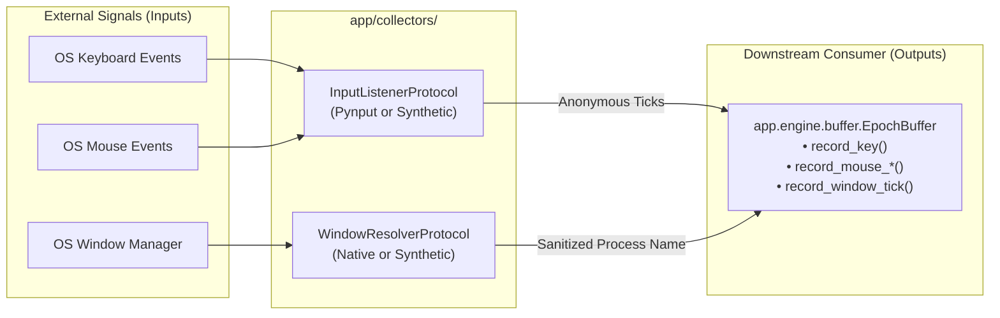

# `local/agent/app/collectors/` Context & Interface Contract

> **Hardware-decoupled, privacy-sanitized OS input listeners and active window process resolvers.**

---

## 1. What, Why, When & How

### What (Scope)

This package is solely responsible for intercepting raw OS-level user activity events (keyboard strokes, mouse clicks, scrolls, and cursor movements) and polling the frontmost active window. It translates raw OS signals into anonymous, sanitized event ticks.

### Why (Rationale)

1. **Zero-Text Privacy Boundary**: To guarantee by construction that typed text, key characters, scancodes, clipboard data, window titles, URLs, and file paths are never inspected, stored, or leaked into downstream layers.
2. **Hardware & Platform Decoupling**: To isolate native OS hooks (`pynput`, macOS `AppKit`, Windows `win32gui`, Linux X11/Wayland) behind strict Python `Protocol` interfaces, enabling headless CI test execution and containerized simulation (`--simulate`) without display servers or accessibility permissions.

### When (Lifecycle)

- **Active Window Poller**: Polled at 4Hz (every 250ms) by `EpochScheduler` during daemon execution.
- **Input Listener**: Runs continuously via background listener threads hooked into OS event queues, forwarding events asynchronously to `EpochBuffer`.

### How (Mechanics)

- **Keyboard**: Evaluates only if the pressed key is a deletion/correction key (`Backspace` / `Delete`). Immediately forwards `(is_correction: bool, delta_ms, timestamp)` to `EpochBuffer`. Key identification is discarded instantly.
- **Mouse**: Captures clicks, scrolls (reading progression), and throttled movements (250ms interval) without recording screen $(X, Y)$ coordinates.
- **Window Polling**: Extracts the frontmost window name via OS probes (`NSWorkspace` on macOS), runs it through `sanitize_process_name()` to strip file names, paths, window titles, and URLs, returning strictly the executable/bundle name (`Code.exe`, `Firefox.app`).
- **Synthetic Simulation**: In `--simulate` mode, `SyntheticInputListener` and `SyntheticWindowResolver` generate deterministic typing bursts and window dwell patterns.

---

## 2. Interface Contract (Inputs & Outputs)

### Inputs (Parameters & Inbound Signals)

- Hardware interrupts from OS event loops via `pynput.keyboard` and `pynput.mouse`.
- Foreground application metadata from `AppKit.NSWorkspace` (or synthetic schedule).
- Target `EpochBuffer` instance injected at initialization.

### Outputs (Exported Public API)

- `CollectorCoordinator`: Folder orchestrator coordinating `input_listener` and `window_resolver` behind a single lifecycle interface.
- `create_input_listener(buffer: InputTickSinkProtocol, simulate=False) -> InputListenerProtocol`: Factory creating native or synthetic input listeners.
- `create_window_resolver(simulate=False) -> WindowResolverProtocol`: Factory creating native or synthetic window resolvers.
- `sanitize_process_name(raw_name: str) -> str`: Pure sanitization utility returning executable/bundle name or `"unknown"`.
- `InputTickSinkProtocol`, `InputListenerProtocol`, `WindowResolverProtocol`, `SyntheticBurstEmitterProtocol`: Structural protocol definitions.

### Invariants & Safety Guarantees

- **Zero Upward or Sibling Imports**: `app/collectors/` must **never** import from `app.config`, `app.service`, `app.engine`, `app.storage`, `app.dimensions`, or `app.api`. Downstream tick accumulators are accepted strictly via `InputTickSinkProtocol`.
- **NEVER** inspect, log, or persist character codes, ASCII values, keysyms, or clipboard content.
- **NEVER** record $(X, Y)$ screen coordinates or mouse positions.
- **NEVER** return window titles, document names, or URLs from window resolution.
- **NEVER** import native GUI frameworks (`AppKit`, `Quartz`, `win32gui`, `pynput`) at module top-level in a way that breaks headless Linux CI runners.

---

## 3. File Inventory

| File | Primary Exports & Classes | Responsibility |
| :--- | :--- | :--- |
| [`coordinator.py`](./coordinator.py) | `CollectorCoordinator` | Folder orchestrator managing both input listener and active window resolver lifecycles. |
| [`protocols.py`](./protocols.py) | `InputTickSinkProtocol`, `InputListenerProtocol`, `WindowResolverProtocol`, `SyntheticBurstEmitterProtocol` | Structural typing contracts for all collector implementations and downstream sinks. |
| [`input_listener.py`](./input_listener.py) | `PynputInputListener`, `SyntheticInputListener`, `create_input_listener`, `is_correction_key` | Low-level OS keyboard/mouse event listener and headless synthetic burst generator. |
| [`window_resolver.py`](./window_resolver.py) | `NativeWindowResolver`, `SyntheticWindowResolver`, `create_window_resolver`, `sanitize_process_name` | Foreground process probe with regex-based path/URL/title stripping and deterministic simulation schedules. |
| [`__init__.py`](./__init__.py) | Re-exports `CollectorCoordinator`, factories, and protocols | Clean public API boundary for the `collectors` package. |

---

## 4. Subfolder Routing

*This package has no child subdirectories. It delegates all processed events to parent sibling [`app/engine/`](../engine/AGENTS.md).*
