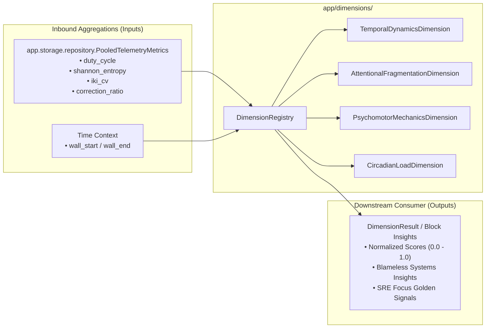

# `local/agent/app/dimensions/` Context & Interface Contract

> **Pluggable Scientific Dimension Engine for ADHD cognitive telemetry & executive-load scoring.**

---

## 1. What, Why, When & How

### What (Scope)

This package houses the **Pluggable Dimension Pattern** (`BaseDimension` and `DimensionRegistry`). It transforms losslessly pooled telemetry metrics (`PooledTelemetryMetrics`) into normalized scientific scores and actionable ADHD cognitive indicators.

### Why (Rationale)

1. **Open-Closed Principle (OCP)**: New scientific dimensions, neuropsychological models, or scoring algorithms can be added without modifying the core ingestion or persistence pipelines.
2. **Translating Observability to Executive Function**: Raw metrics (such as keystroke intervals or window dwell times) are meaningless to an end-user until converted into the 4 Barkley-aligned scientific dimensions:
   - **Temporal Dynamics**: How long the user sustains focus without cognitive stalls.
   - **Attentional Fragmentation**: Whether attention is stable or thrashing between apps.
   - **Psychomotor Mechanics**: Physical cognitive strain and motor fatigue inferred from key rhythm variability.
   - **Circadian & Cumulative Load**: Fatigue accumulated over hours of unbroken screen time and post-prandial dips.

### When (Lifecycle)

- Evaluated when an `ActivityBlock` is sealed (every 60s/90s) by the Chunker.
- Evaluated on-demand by FastAPI endpoints (`/api/v1/summary/today`) to generate user-facing focus reports.

### How (Mechanics)

- Subclasses implement `BaseDimension.evaluate(metrics: PooledTelemetryMetrics) -> DimensionResult`.
- Dimensions register automatically with `DimensionRegistry`.
- When called, the registry runs all active dimensions, bundling results into a comprehensive cognitive profile for the activity block.

---

## 2. Interface Contract (Inputs & Outputs)

### Inputs (Parameters)

- `PooledTelemetryMetrics` instance containing pooled metrics across the target time window.
- Epoch/block time bounds (`timestamp_start`, `timestamp_end`).

### Outputs (Exported Public API)

- `DimensionRegistry` & `create_default_registry()`: Folder orchestrator managing registered dimensions and running deterministic batch evaluations.
- `BaseDimension`: Abstract base class enforcing the dimension evaluation interface.
- `DimensionContext`, `DimensionEvaluation`, `DimensionEpochProtocol`, `DimensionPooledMetricsProtocol`: Self-contained evaluation context, output record, and structural input protocols.
- The 4 Core Dimension classes:
  - `TemporalDynamicsDimension`
  - `AttentionalFragmentationDimension`
  - `PsychomotorMechanicsDimension`
  - `CircadianLoadDimension`

### Invariants & Safety Guarantees

- **Zero Upward or Sibling Imports**: `app/dimensions/` must **never** import from `app.config`, `app.service`, `app.collectors`, `app.engine`, `app.storage`, or `app.api`. Epoch and pooled metric inputs are typed strictly via `DimensionEpochProtocol` and `DimensionPooledMetricsProtocol` in [`base.py`](./base.py).
- **Blameless SRE Framing**: Insights must never use guilt-inducing language (e.g. *"You were distracted"*). Instead, provide objective systems telemetry (e.g. *"High application thrashing detected—task scope may need resizing"*).
- **Statistically Guarded**: Psychomotor scores must yield `state_label = "insufficient_keystroke_sample"` and `strain_score = 0.0` if `is_psychomotor_valid` is `False` ($N < 10$).

---

## 3. File Inventory

| File | Primary Exports & Classes | Responsibility |
| :--- | :--- | :--- |
| [`base.py`](./base.py) | `DimensionRegistry`, `BaseDimension`, `DimensionContext`, `DimensionEvaluation`, `DimensionEpochProtocol`, `DimensionPooledMetricsProtocol`, `pool_dimension_epochs` | Folder orchestrator, abstract base class, structural protocols, and self-contained pooling. |
| [`temporal.py`](./temporal.py) | `TemporalDynamicsDimension` | Duty cycle, continuous focus duration, micro-pause rate, and active reading detection. |
| [`attentional.py`](./attentional.py) | `AttentionalFragmentationDimension` | Shannon entropy ($H$), primary dwell ratio ($p_{\max}$), and context-switches per minute. |
| [`psychomotor.py`](./psychomotor.py) | `PsychomotorMechanicsDimension` | Inter-keystroke interval CV and correction keystroke ratio ($N \ge 10$ guarded). |
| [`circadian.py`](./circadian.py) | `CircadianLoadDimension`, `compute_continuous_load_minutes` | Time-of-day slotting, post-prandial dip ($13:00\text{--}15:00$), and unbroken screen strain. |
| [`__init__.py`](./__init__.py) | `create_default_registry`, dimension exports | Public boundary for the pluggable dimension engine. |

---

## 4. Subfolder Routing

*This package has no child subdirectories. It consumes pooled telemetry from [`app/storage/`](../storage/AGENTS.md) and provides evaluated insights to [`app/engine/`](../engine/AGENTS.md) and [`app/api/`](../api/AGENTS.md).*
