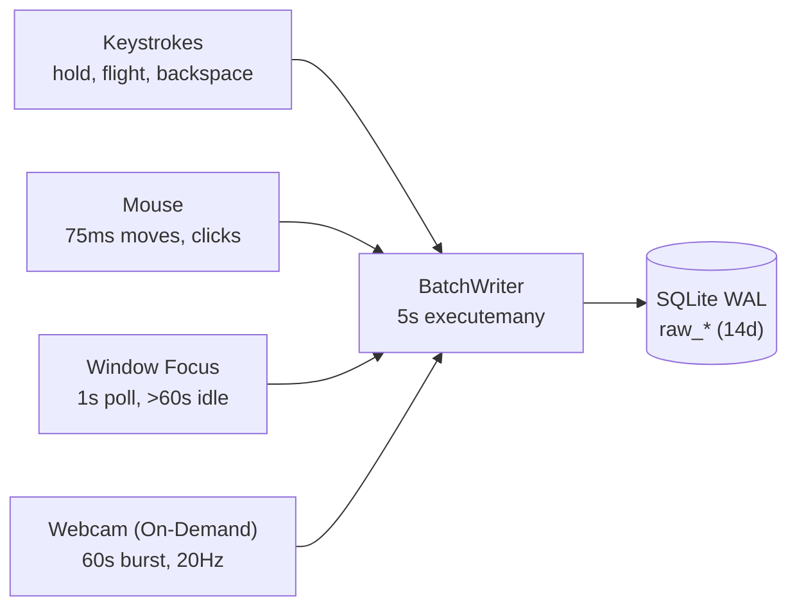
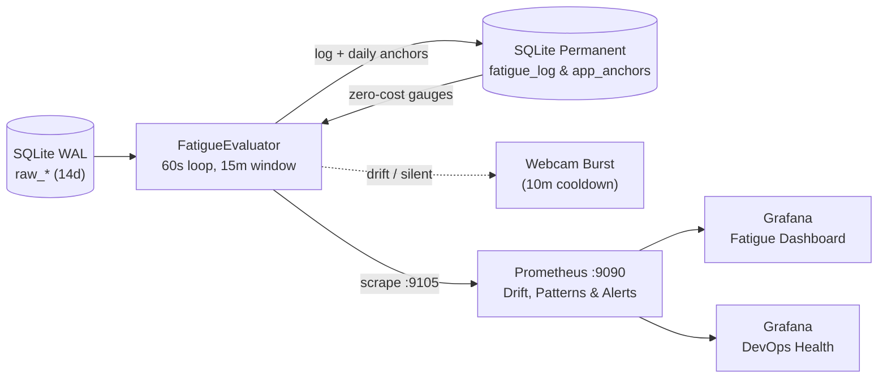
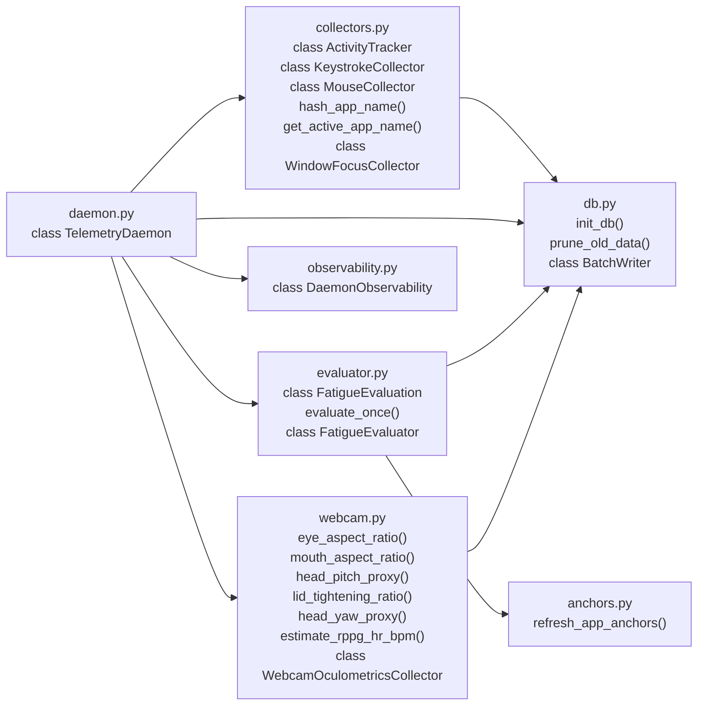
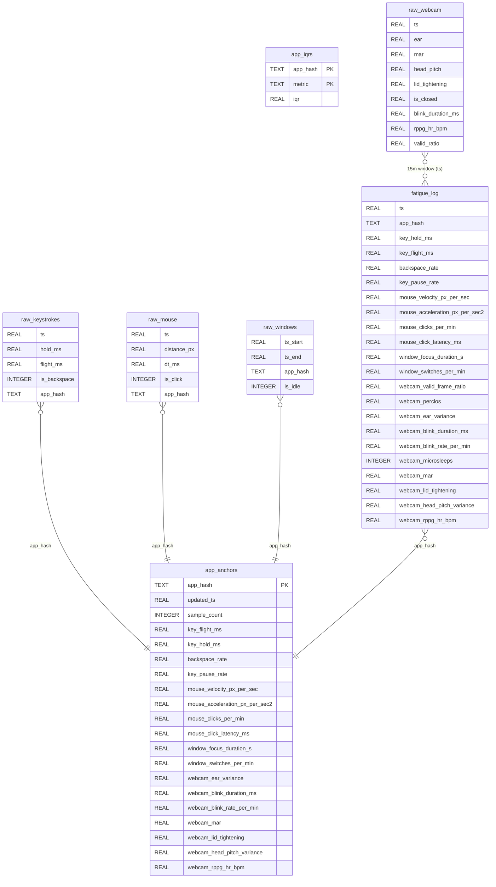
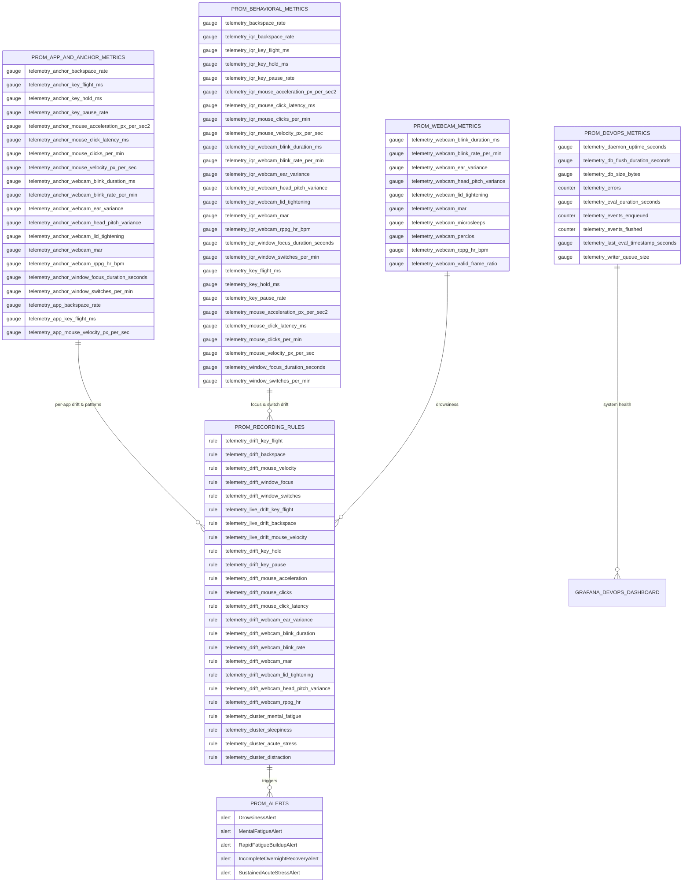
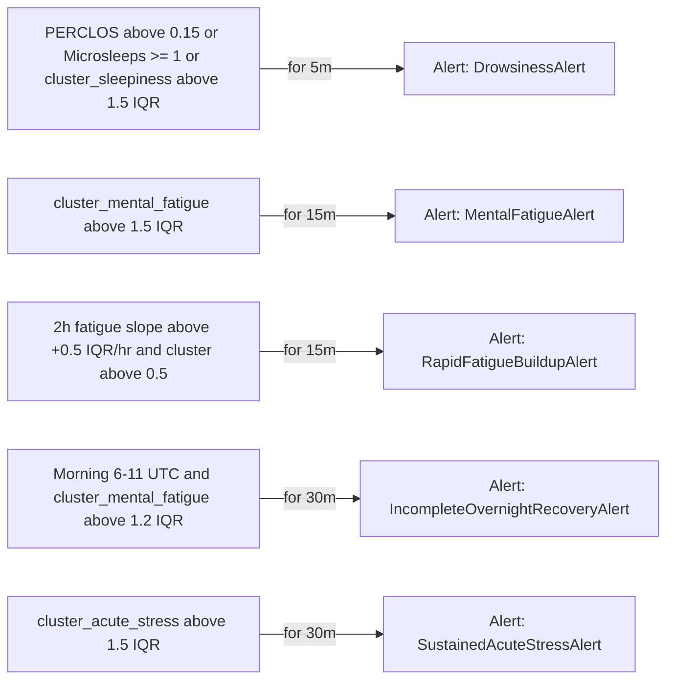
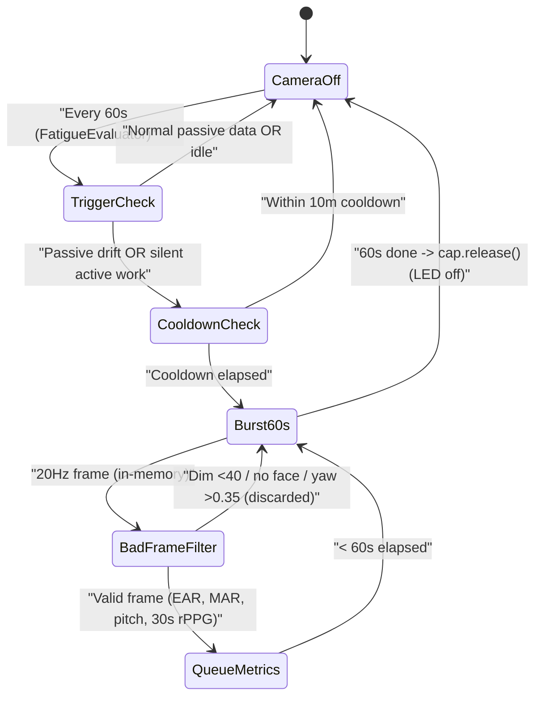
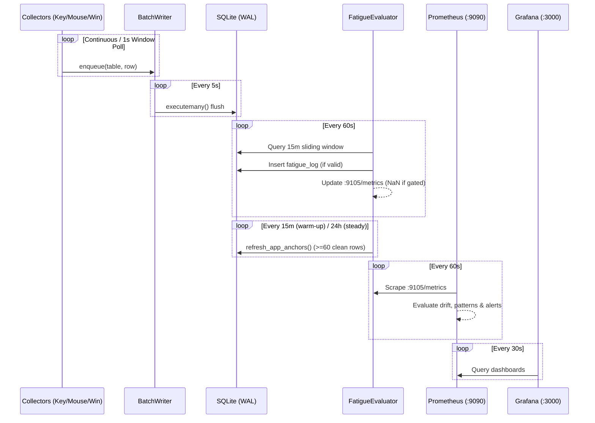

# Telemetry Architecture & Code Flowchart

> Auto-generated by `generate_flowchart.py`. Open in VS Code and press **`Cmd+Shift+V`** to preview.

## 1a. Ingestion & Storage

## 1b. Evaluation, Anchors, Prometheus & Grafana

## 2. Module Dependency Graph (Auto-Extracted from AST)

## 3. SQLite Database Schema (Auto-Extracted from `SCHEMA_SQL`)

## 4. Prometheus Metrics & Rules (Auto-Extracted)

## 5. Cluster Alert Decision Tree (IQR-Normalized)

## 6. On-Demand Webcam State Machine

## 7. Runtime Timing Sequence

