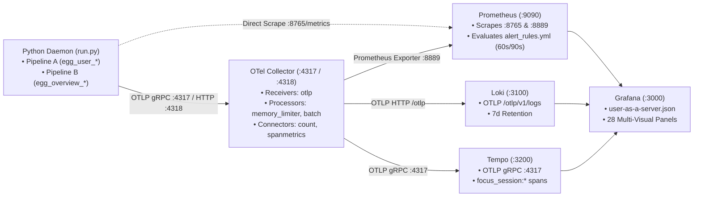

# `local/telemetry` — EGG Cognitive Host Telemetry & SRE Observability

A self-contained, privacy-by-construction Python 3.12 daemon and containerized observability stack (**"User-as-a-Server"**). Passively samples hardware interaction timing and foreground application switches across rolling sliding windows, evaluates **two stateful cognitive pipelines in parallel** (Pipeline A: 4 Physical SRE Dimensions; Pipeline B: 6 Work Categories & 6 Stateful Overview Dimensions), exports telemetry over OTLP gRPC/HTTP, and serves Prometheus, Loki, Tempo, and Grafana dashboards strictly on `127.0.0.1`.

This package can run as a **standalone product** or as part of the broader EGG monorepo.

---

## 1. Prerequisites

Before running the suite, ensure your machine satisfies the following prerequisites:

### 1.1 Core Tooling

- **Python 3.12+**: Modern Python runtime.
- **`uv` Package Manager**: Fast, deterministic package manager:

  ```bash
  curl -LsSf https://astral.sh/uv/install.sh | sh
  ```

- **Docker Desktop / Docker Engine (v2) with Compose**:
  - Required to run the local containerized stack (Grafana, Prometheus, Loki, Tempo, OTel Collector).
  - *Note*: If Docker is not installed or running, the telemetry daemon can still run in standalone host mode (`--no-stack`) serving its embedded REST & Prometheus API on `127.0.0.1:8765`.

### 1.2 Operating System Input Permissions

To passively monitor interaction timing without text capture, your OS requires appropriate input event privileges:

#### macOS (Accessibility & Input Monitoring)

1. Open **System Settings** $\rightarrow$ **Privacy & Security** $\rightarrow$ **Accessibility**.
2. Enable your terminal emulator (e.g., **Terminal.app**, **iTerm2**, **Alacritty**, or **VS Code**).
3. Check **Input Monitoring** if prompted.
4. Restart your terminal application so macOS updates its process security tokens.

#### Linux (X11 vs. Wayland)

- **X11 / Xorg (Recommended)**: Works out of the box with `xdotool` and `pynput`.
- **Wayland**: Security policies isolate input across windows. To grant input device access, ensure your user belongs to the `input` group:

  ```bash
  sudo usermod -aG input $USER
  ```

  Then log out and log back in.

#### Windows

- Native Windows APIs (`user32.dll` and `kernel32.dll`) are supported out of the box with standard user privileges.

#### Zero-Permission Mode (Synthetic Telemetry)

To run in CI or test without granting OS permissions:

```bash
uv run run.py --synthetic
```

---

## 2. Quickstart: One-Command Execution

### Default: Start Everything (Docker Stack + Python Daemon)

```bash
cd local/telemetry
uv run run.py
```

This single command:

1. Automatically boots the Docker Compose observability stack in the `egg-telemetry` project namespace.
2. Displays the interactive dashboard discovery banner with clickable URLs.
3. Launches the local Python telemetry daemon collecting real-time host metrics across both parallel pipelines.
4. On `Ctrl+C`, cleanly stops the daemon and stops the containers.

---

## 3. UI Endpoints & Dashboards

When the stack starts, access the following pre-configured services:

| Service | URL | Description | Default Credentials |
| :--- | :--- | :--- | :--- |
| **Grafana Dashboard** | `http://127.0.0.1:3000/d/user-as-a-server` | 28-panel multi-visual comparison dashboard for Pipeline A (4 SRE Dimensions) & Pipeline B (6 Overview Dimensions). | `admin` / `eggadmin` |
| **Prometheus TSDB** | `http://127.0.0.1:9090` | Raw time-series database, recording rules, `for: 60s/90s` alert rules, and PromQL explorer. | *None (open loopback)* |
| **Loki Logs** | `http://127.0.0.1:3000/explore` *(Loki)* | Structured JSON log stream of state ticks, discrete focus/switch/interruption events, and `unclassified_segment` gaps. | `admin` / `eggadmin` |
| **Tempo Traces** | `http://127.0.0.1:3000/explore` *(Tempo)* | Active application focus span traces (`focus_session:<process>`) capturing context switches. | `admin` / `eggadmin` |
| **Host Daemon API** | `http://127.0.0.1:8765` | Localhost REST & Prometheus (`/metrics`) API for UI task breakdown clients. | *None (loopback only)* |
| **Interactive API Docs** | `http://127.0.0.1:8765/docs` | Swagger OpenAPI specification and live query explorer. | *None (loopback only)* |
| **Health Check** | `http://127.0.0.1:8765/health` | Daemon heartbeat and overall SRE system status. | *None (loopback only)* |

---

## 4. CLI Commands & Options

```bash
# Health check all Docker containers and daemon HTTP endpoints
uv run run.py --status

# Run daemon only without Docker (for CI or external observability)
uv run run.py --no-stack

# Start Docker containers only and leave them running
uv run run.py --stack-only

# Stop Docker containers (preserves container state)
uv run run.py --stop

# Teardown Docker containers and network
uv run run.py --down

# Teardown Docker containers and purge persistent data volumes
uv run run.py --clean

# Run with synthetic test probes for a fixed 10-second duration
uv run run.py --synthetic --duration 10
```

---

## 5. DevOps Observability & Dual-Pipeline Learning Guide

`local/telemetry` is designed as a hands-on **SRE & Observability Reference Architecture** where you can inspect how metrics, logs, and traces flow from a stateful Python daemon through the **OpenTelemetry Collector**, **Prometheus**, **Loki**, **Tempo**, and **Grafana**, and compare two different ways of modeling human cognitive telemetry side-by-side.

### 5.1 Dual-Pipeline Comparison: `analysis/strain/` vs. `analysis/workflow/`

Both analysis submodules are combined inside `app/analysis/` (`CognitiveAnalyzer`) and run on every tick so you can compare them directly in Grafana:

| Aspect | `analysis/strain/` — 4-Dimension SRE Engine (`egg_user_*`) | `analysis/workflow/` — 6-Dimension Overview Engine (`egg_overview_*`) |
| :--- | :--- | :--- |
| **Core Metaphor** | **USE Method / Four Golden Signals** applied to a human operator (Utilization, Saturation, Errors, Uptime). | **Behavioral Sessionization & Rule-Based Work Categories** (`## Overview/## Overview.md`). |
| **Submodules Combined** | `temporal.py` + `attentional.py` + `psychomotor.py` + `uptime.py` $\rightarrow$ `evaluate_strain()` | `classifier.py` (6 categories) + `sessions.py` (focus, residue, interruptions) + `rhythms.py` (ultradian, chronotype, typing bursts) $\rightarrow$ `WorkflowEngine` |
| **Work / Modality Classification** | Continuous physical ratios (`duty_cycle`, `reading` vs. `stalled` modality). | **6 Mutually Exclusive Work Categories** evaluated in strict priority order: `idle` $\rightarrow$ `communicating` $\rightarrow$ `consuming` $\rightarrow$ `producing` $\rightarrow$ `navigating` ($>6$ switches in 5m) $\rightarrow$ `unclassified` (with `failed_rule`). |
| **Dimensions Evaluated** | 1. **Temporal** (`duty_cycle_ratio`, `idle_seconds`)<br/>2. **Attentional** (`shannon_entropy_bits`, `context_switch_rate_per_min`)<br/>3. **Psychomotor** (`keystroke_iki_cv_ratio`, `correction_keystroke_ratio`)<br/>4. **Uptime** (`continuous_session_uptime_seconds`) | 1. **Flow & Sustained Focus** ($\ge 5\text{m}$ sessions, $>25\text{m}$ deep work)<br/>2. **Attention Residue** (30m departure/return ledger)<br/>3. **Interruption & Resumption Lag** (`comms` switches + lag to $\ge 10\text{s}$ input)<br/>4. **Ultradian Rhythms** (per-min intensity + autocorrelation cycle period)<br/>5. **Chronotype** (24 hourly deep-work buckets `00`..`23` + circular peak hour)<br/>6. **Typing Rhythm & Pauses** (`>2s` pause rate, burst length, `composing` vs. `transcribing`) |

### 5.2 How Each Observability Tool Is Configured & Wired



1. **OpenTelemetry Collector ([`observability/otel-collector/otel-collector-config.yml`](./observability/otel-collector/otel-collector-config.yml))**:
   - **Receivers (`otlp`)**: Accepts gRPC (`:4317`) and HTTP (`:4318`) telemetry from the Python daemon.
   - **Processors (`memory_limiter`, `batch`)**: Protects memory and batches telemetry before export.
   - **Connectors (`count`, `spanmetrics`)**: Demonstrates how the Collector can **derive metrics from logs and traces** without changing application code:
     - `count`: Counts structured log records by `event_type` and exports them as Prometheus metrics (`egg_otel_log_events_total`).
     - `spanmetrics`: Computes **RED metrics** (Request rate and Duration histograms) from Tempo focus spans (`focus_session:<process>`), partitioned by `focus.process_name` and `focus.category`.
   - **Exporters (`prometheus`, `otlphttp/loki`, `otlp/tempo`)**: Notice `add_metric_suffixes: false` on the Prometheus exporter so metric names from the OTel SDK (`egg_user_duty_cycle_ratio`) match the direct FastAPI `/metrics` endpoint (`:8765/metrics`) 1-to-1.
2. **Prometheus ([`observability/prometheus/prometheus.yml`](./observability/prometheus/prometheus.yml) & [`alert_rules.yml`](./observability/prometheus/alert_rules.yml))**:
   - **Scrape Targets**: Scrapes both `host.docker.internal:8765/metrics` (`job="egg-host-daemon-direct"`) and `otel-collector:8889/metrics` (`job="egg-otel-collector"`).
   - **Recording Rules (`record:`)**: Pre-computes rolling 1-minute rates (`egg:keystrokes_per_second:rate1m`, `egg:context_switches_per_minute:rate1m`) and composite utilization ratios.
   - **Hysteresis Alerting Rules (`alert:` + `for:`)**: Implements EGG's **60s/90s Alert Debouncing** directly in Prometheus (`EggHighAttentionalThrashing` with `for: 60s`, `EggPsychomotorThroughputDegradation` with `for: 90s`, `EggExtendedUnbrokenLoad` with `for: 60s`, `EggHighUnclassifiedWorkShare` with `for: 90s`). Transient $<60\text{s}$ spikes remain in `Pending` state and never fire unless sustained.
3. **Grafana Loki ([`observability/loki/loki-config.yml`](./observability/loki/loki-config.yml))**:
   - Ingests structured JSON logs via native OTLP (`/otlp/v1/logs`) with 7-day retention (`retention_period: 168h`).
   - Captures both periodic state ticks (`cognitive_state_tick`) and **discrete state transitions** (`focus_start`, `focus_end`, `switch`, `idle_start`, `interruption`, `resumed`, `unclassified_segment`, `sre_alert`).
4. **Grafana Tempo ([`observability/tempo/tempo-config.yml`](./observability/tempo/tempo-config.yml))**:
   - Receives distributed trace spans (`focus_session:<process>`) whenever you switch foreground windows, recording `focus.process_name`, `focus.category`, `focus.dwell_seconds`, and `focus.interrupted_by`.
5. **Grafana Multi-Visual Dashboard ([`observability/grafana/dashboards/user-as-a-server.json`](./observability/grafana/dashboards/user-as-a-server.json))**:
   - Organizes 28 panels across 8 rows so you can compare how different panel types represent the same underlying metric:
     - **Stat Panel (with Sparkline)**: Best for headline KPIs (`Current Work Category`, `Focus Session (s)`, `Ultradian Period (m)`).
     - **Radial Gauge**: Best for bounded ratios with clear zones (`Duty Cycle [0..1]`, `Correction Ratio`).
     - **Horizontal LCD Bar Gauge**: Best for comparing multiple dimensions side-by-side (`Duty Cycle` vs. `Entropy` vs. `IKI CV` vs. `Correction Ratio`).
     - **Time Series (Line / Staircase / Stacked Area / Bars)**: Best for trends, step transitions (`stepAfter`), and 100%-stacked category share over time.
     - **Pie / Donut Chart**: Best for proportional breakdowns (`Work Category Distribution`).
     - **State Timeline**: Best for discrete categorical states over time (`Active Work Category` and `Typing Mode: Composing vs. Transcribing`).
     - **Logs Panel**: Best for inspecting discrete JSON events and `"Learning from Gaps"` (`unclassified_segment`).

### 5.3 Ready-to-Run Query Examples (PromQL, LogQL & TraceQL)

#### PromQL (Open `http://127.0.0.1:9090` or Grafana Explore $\rightarrow$ Prometheus)

```promql
# 1. Pipeline A vs. Pipeline B: Compare active Duty Cycle with current Focus Session duration
egg_user_duty_cycle_ratio{job="egg-host-daemon-direct"}
egg_overview_focus_session_seconds{job="egg-host-daemon-direct"}

# 2. View cumulative seconds spent in each of the 6 Work Categories (Pipeline B)
egg_overview_work_category_seconds{job="egg-host-daemon-direct"}

# 3. Share of total time spent in 'unclassified' activity ("Learning from Gaps")
egg_overview_unclassified_fraction_ratio{job="egg-host-daemon-direct"}

# 4. Chronotype: Deep-work minutes accumulated in each hour of the day (00..23)
egg_overview_chronotype_deep_work_minutes_by_hour{job="egg-host-daemon-direct"}

# 5. Inspect currently Pending or Firing Prometheus hysteresis alerts (60s/90s debounce)
ALERTS{alertname=~"Egg.*"}
```

#### LogQL (Open `http://127.0.0.1:3000/explore` $\rightarrow$ Loki)

```logql
# 1. All discrete Pipeline B Overview events (focus_start, focus_end, switch, interruption, resumed)
{service_name="egg-local-telemetry"} | json | event_type=~"focus_start|focus_end|switch|idle_start|interruption|resumed"

# 2. "Learning from Gaps" — Inspect unclassified segments and which rule failed
{service_name="egg-local-telemetry"} | json | event_type="unclassified_segment" | line_format "app={{.app_category}} keys={{.keystroke_bucket}} dur={{.duration_seconds}}s failed={{.failed_rule}}"

# 3. Count unclassified segments by failed_rule over the last 15 minutes
sum by (failed_rule) (count_over_time({service_name="egg-local-telemetry"} | json | event_type="unclassified_segment" [15m]))
```

#### TraceQL (Open `http://127.0.0.1:3000/explore` $\rightarrow$ Tempo)

```traceql
# 1. Find all application focus spans longer than 30 seconds
{ span.focus.dwell_seconds > 30 }

# 2. Find focus sessions in 'dev' tools that were interrupted by 'Slack'
{ span.focus.category = "dev" && span.focus.interrupted_by = "Slack" }
```

---

## 6. Feature Module Architecture & Privacy Guarantees

`local/telemetry/app/` is organized into **4 standalone feature modules** coordinated by `service.py`:

- **`collector/`**: Combines `input_hook.py`, `window_probe.py`, and `sliding_window.py` to output a privacy-safe 60s `ActivitySnapshot` (and tick counter deltas).
- **`analysis/`**: Combines `strain/` (4 SRE dimensions + health aggregator) and `workflow/` (`classifier.py` + `sessions.py` + `rhythms.py`) into a pure, zero-I/O `CognitiveState`.
- **`exporters/`**: Combines `otel.py`, declarative `metrics.py`, stateful alert/heartbeat `logs.py`, and Tempo `traces.py` behind a single `.publish(snapshot, state)` call.
- **`api/`**: Loopback-validated (`127.0.0.1:8765`) FastAPI server exposing `/health`, `/metrics`, `/api/v1/status`, and `/api/v1/state`.

### Privacy Invariants

1. **Zero Content Capture**: Never records key characters, scancodes, clipboard text, window titles, or URLs.
2. **Sanitized Process Basenames Only**: Only process binaries are identified (e.g., `Code.exe`, `Terminal.app`).
3. **Strict Loopback Binding (`127.0.0.1`)**: All services bind exclusively to localhost and enforce `TrustedHostMiddleware`.

---

## 7. Verification & Quality Gates

Run the automated test and quality gate pipeline:

```bash
# 1. Format check
uv run ruff format --check .

# 2. Linting
uv run ruff check .

# 3. Strict static type analysis
uv run mypy --strict app tests run.py

# 4. Unit tests and coverage floor (>= 90%)
uv run pytest --cov=app --cov-fail-under=90
```
