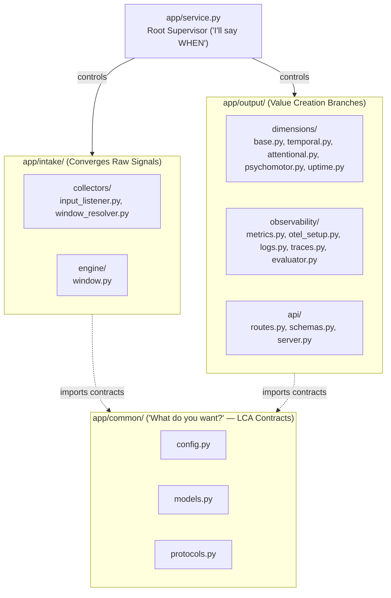

# `local/telemetry/app/` Context & Interface Contract

> **Core Python application package: Hourglass Data Architecture (`intake/` $\rightarrow$ `output/`), LCA Crossroads Contracts (`common/`), and Root Supervisor (`service.py`).**

---

## 1. What, Why, When & How

### What (Scope)

This package is the top-level Python application module for `local/telemetry`. It is structured around the **Hourglass Data Architecture** and the **Lowest Common Ancestor (LCA) "When vs. What" Rule**:

1. **`service.py` ("I'll say WHEN" — Root Supervisor)**: Controls runtime lifecycle and timing, wiring `intake/` $\rightarrow$ `output/`.
2. **`common/` ("What do you want?" — LCA Crossroads Contracts)**: Shared immutable constants (`config.py`), domain value objects and statistical pooling math (`models.py`), and cross-package structural interfaces (`protocols.py`).
3. **`intake/` (Converges Raw Signals)**: Collects anonymous OS/hardware interaction timing (`collectors/`) and maintains a thread-safe sliding window buffer (`engine/window.py`).
4. **`output/` (Value Creation Branches)**: Evaluates the 4 physical SRE dimensions (`dimensions/`), manages the OpenTelemetry/Loki/Tempo export pipeline (`observability/`), and serves the localhost FastAPI + Prometheus gateway (`api/`).

### Why (Rationale)

1. **Self-Documenting Folder Tree**: Opening `app/` immediately communicates how data flows through the system (`intake/` $\rightarrow$ `output/`), with shared contracts in `common/` and lifecycle timing in `service.py`.
2. **Clean Dependency Graph**:
   - **Downward ("I'll say when")**: Only `service.py` imports across `intake/` and `output/`.
   - **Upward ("What do you want?")**: Leaf packages (`intake/collectors`, `intake/engine`, `output/dimensions`, `output/observability`, `output/api`) import shared types, constants, and protocols from `app/common/` without ever importing sibling packages.
3. **Zero Middleman Boilerplate**: Each leaf package exposes its public API directly through `__init__.py` and worker modules without redundant wrapper classes.

### When (Lifecycle)

- Initialized by `run.py` when starting `local/telemetry`.
- Remains alive for the entire duration of the background service.

### How (Mechanics)

- **Startup**:
  1. Resolves configuration from `app.common.config`.
  2. Instantiates `SlidingWindowBuffer` and creates collectors via `create_input_listener` and `create_window_resolver` (using `--simulate` flag if provided).
  3. Initializes OpenTelemetry managers (`OTelTelemetryManager`, `CognitiveMetricsRecorder`, `FocusSessionTracer`, `SREEventLogger`).
  4. Launches `TelemetryService.run()` and concurrent `uvicorn.Server` on `127.0.0.1:8765`.
- **Shutdown**: Intercepts OS signals (`SIGINT`, `SIGTERM`), halts listener hooks, flushes and shuts down OpenTelemetry exporters, and cleanly closes the API server.

---

## 2. Interface Contract (Hourglass & LCA Architecture)

### Invariants & Safety Guarantees

- **Hourglass + LCA Isolation**: `app/service.py` is the **only** module permitted to import across `intake/` and `output/`. Leaf packages must never import from each other or from `app/service.py`, and may only import from themselves or upward from `app/common/*`, enforced via AST inspection in `tests/test_architecture_boundaries.py`.
- **Zero Unpersisted Resource Leaks**: `TelemetryService` always cleanly stops background listener hooks and flushes OTel providers when stopped.
- **Strict Typing**: All internal modules pass `mypy --strict`.

---

## 3. File & Pillar Inventory

| Path | Role | Primary Exports & Responsibility |
| :--- | :--- | :--- |
| [`service.py`](./service.py) | Root Supervisor (*"Says WHEN"*) | `TelemetryService`, `build_arg_parser`, `run_from_cli`. Wires `intake` $\rightarrow$ `output` and manages graceful teardown. |
| [`common/`](./common/AGENTS.md) | LCA Crossroads (*"Says WHAT"*) | `DaemonConfig`, `PooledTelemetryMetrics`, `DimensionEvaluation`, `CognitiveStrainReport`, `SchedulerDiagnostics`, and shared `Protocol` definitions. |
| [`intake/`](./intake/AGENTS.md) | Intake Pillar | `collectors/` (hardware/window hooks) and `engine/` (in-memory `SlidingWindowBuffer`). |
| [`output/`](./output/AGENTS.md) | Value Creation Pillar | `dimensions/` (4-Dimension SRE Engine), `observability/` (OTel metrics, Loki logs, Tempo traces), and `api/` (FastAPI `127.0.0.1:8765` + Prometheus `/metrics`). |
| [`__init__.py`](./__init__.py) | Package marker | Package identity. |

---

## 4. Subfolder Routing

- [`common/`](./common/AGENTS.md): Shared configuration, immutable DTOs, lossless statistical pooling math, and structural protocols.
- [`intake/`](./intake/AGENTS.md): Raw signal collection (`collectors/`) and sliding window accumulation (`engine/`).
- [`output/`](./output/AGENTS.md): Scientific dimension evaluators (`dimensions/`), SRE observability exporters (`observability/`), and localhost HTTP gateway (`api/`).
